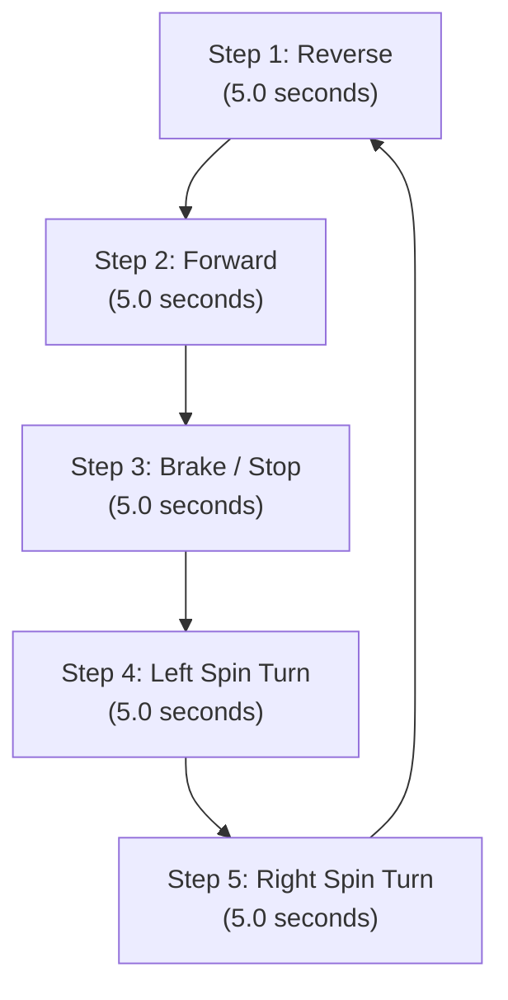

# Arduino Robotics Projects

A comprehensive engineering portfolio of embedded robotics firmware demonstrating modular Arduino implementations covering sensor-based closed-loop following, wireless serial teleoperation, and open-loop timed trajectory execution.

---

## Table of Contents

- [Repository Overview](#repository-overview)
- [Repository Structure](#repository-structure)
- [Common Hardware Architecture](#common-hardware-architecture)
  - [Shared Platform Components](#shared-platform-components)
  - [Motor Driver Topologies & Pin Mappings](#motor-driver-topologies--pin-mappings)
- [Project Implementations](#project-implementations)
  - [1. Object Following Robot](#1-object-following-robot)
  - [2. Bluetooth Controlled Robot](#2-bluetooth-controlled-robot)
  - [3. Timer Controlled Robot](#3-timer-controlled-robot)
- [Comparative Technical Summary](#comparative-technical-summary)
- [Technologies & Tools Used](#technologies--tools-used)
- [Engineering Skills Gained](#engineering-skills-gained)
- [Potential Future Enhancements](#potential-future-enhancements)

---

## Repository Overview

This repository demonstrates practical embedded software development for two-wheel differential drive mobile robots using the **Arduino UNO (ATmega328P)** microcontroller and the **L293D dual H-bridge motor driver**. 

The three projects showcase distinct embedded control paradigms:
1. **Sensory Closed-Loop Control:** Real-time distance tracking and threshold evaluation using ultrasonic time-of-flight measurements.
2. **Asynchronous Teleoperation:** Wireless command parsing over software UART with state-dependent differential pivot steering.
3. **Sequential State Execution:** Deterministic, open-loop kinematic routines executing predefined motion profiles.

---

## Repository Structure

```
Robotics-Projects/
│
├── README.md
│
├── Object-Following-Robot/
│   └── object-following-robot.ino
│
├── Bluetooth-Controlled-Robot/
│   └── bluetooth-robot.ino
│
└── Timer-Controlled-Robot/
    └── timer-robot.ino
```

---

## Common Hardware Architecture

### Shared Platform Components

All three mobile robots are built on a standard differential drive chassis and share core embedded hardware:

| Component | Technical Specification | Function |
| :--- | :--- | :--- |
| **Microcontroller** | Arduino UNO (Microchip ATmega328P, 16 MHz, 5V logic) | Central processing unit, GPIO control, timing, and peripheral communication |
| **Motor Driver IC** | L293D Dual H-Bridge Motor Driver | Inductive load switching; provides bidirectional DC motor current drive |
| **Actuators** | 2 × BO DC Gear Motors (configured as Left and Right drive wheels) | Differential drive locomotion |
| **Chassis** | 2-wheel differential chassis + 1 passive caster wheel | Physical robotic platform |

---

### Motor Driver Topologies & Pin Mappings

The source code reveals two distinct L293D wiring topologies across these projects. They are **not** identical:

* **Topology 1 (Dedicated PWM Speed Enable):** Used by both the [Bluetooth Controlled Robot](./Bluetooth-Controlled-Robot/bluetooth-robot.ino) and the [Timer Controlled Robot](./Timer-Controlled-Robot/timer-robot.ino). Hardware PWM pins drive the L293D enable inputs (`ENA`, `ENB`), and digital pins drive the H-bridge direction logic (`IN1`–`IN4`).
* **Topology 2 (Direct Direction Drive):** Used by the [Object Following Robot](./Object-Following-Robot/object-following-robot.ino). Direction logic pins (`IN1`–`IN4`) connect directly to microcontroller digital pins; driver enable pins are tied to 5V (logic HIGH) in hardware, running motors at a fixed duty cycle.

#### Genuine Shared Pinout (Bluetooth & Timer Robots):

| L293D Pin | Arduino Uno Pin | Pin Type | Assigned Motor Function |
| :--- | :--- | :--- | :--- |
| **ENA** | **D5** | Hardware PWM | Left Motor Speed Enable |
| **IN1** | **D8** | Digital Output | Left Motor Direction Input 1 |
| **IN2** | **D9** | Digital Output | Left Motor Direction Input 2 |
| **ENB** | **D6** | Hardware PWM | Right Motor Speed Enable |
| **IN3** | **D10** | Digital Output | Right Motor Direction Input 1 |
| **IN4** | **D11** | Digital Output | Right Motor Direction Input 2 |

---

## Project Implementations

### 1. Object Following Robot

* **Source File:** [`object-following-robot.ino`](./Object-Following-Robot/object-following-robot.ino)
* **Objective:** Maintain a target distance behind a moving object within a longitudinal threshold window using real-time ultrasonic ranging.

#### Hardware & Wiring

| Subsystem | Signal Name | Arduino Uno Pin | Description |
| :--- | :--- | :--- | :--- |
| **HC-SR04 Sensor** | `TRIG_PIN` | **D2** | $10\,\mu\text{s}$ ultrasonic pulse trigger |
| **HC-SR04 Sensor** | `ECHO_PIN` | **D3** | Ultrasonic echo pulse input capture |
| **L293D Motor Driver** | `IN1` | **D6** | Left Motor Driver Input 1 |
| **L293D Motor Driver** | `IN2` | **D7** | Left Motor Driver Input 2 |
| **L293D Motor Driver** | `IN3` | **D10** | Right Motor Driver Input 1 |
| **L293D Motor Driver** | `IN4` | **D11** | Right Motor Driver Input 2 |
| **L293D Enable** | `ENA`, `ENB` | *Hardwired* | Connected to 5V for continuous full-speed operation |

#### Working Principle & Control Logic

The firmware interfaces an **HC-SR04 ultrasonic sensor** operating on time-of-flight acoustic measurement:
1. A $10\,\mu\text{s}$ pulse is transmitted on `TRIG_PIN` after a $2\,\mu\text{s}$ low baseline.
2. The width of the return pulse on `ECHO_PIN` is measured using `pulseIn()` with a $30{,}000\,\mu\text{s}$ timeout ($\approx 5.1\,\text{m}$ theoretical cutoff).
3. Distance in centimeters is calculated using the speed of sound in dry air ($\approx 340\,\text{m/s}$ or $0.034\,\text{cm}/\mu\text{s}$):
   $$\text{Distance (cm)} = \frac{\text{duration} \times 0.034}{2}$$
4. Distance data is logged to the serial terminal at 9600 baud and evaluated against configured operational limits:
   * `STOP_DISTANCE = 8 cm`
   * `FOLLOW_DISTANCE = 20 cm`

#### Decision Table:
| Measured Distance ($d$) | Vehicle Response | Motor States (`IN1, IN2, IN3, IN4`) | Rationale |
| :--- | :--- | :--- | :--- |
| $d == 0\,\text{cm}$ | **Stop** | `LOW, LOW, LOW, LOW` | Timeout or out-of-range; failsafe stop |
| $d \le 8\,\text{cm}$ | **Stop** | `LOW, LOW, LOW, LOW` | Minimum safety buffer reached; prevents collision |
| $8\,\text{cm} < d \le 20\,\text{cm}$ | **Forward** | `HIGH, LOW, HIGH, LOW` | Target within tracking range; advance toward object |
| $d > 20\,\text{cm}$ | **Stop** | `LOW, LOW, LOW, LOW` | Target exceeds follow threshold; halt locomotion |

> **Implementation Note:** The firmware implements a 1-dimensional longitudinal tracking algorithm. It does not execute lateral steering or reverse tracking.

---

### 2. Bluetooth Controlled Robot

* **Source File:** [`bluetooth-robot.ino`](./Bluetooth-Controlled-Robot/bluetooth-robot.ino)
* **Objective:** Teleoperate vehicle translation and directional orientation wirelessly via serial commands transmitted from a paired Bluetooth device.

#### Hardware & Wiring

*Motor driver connections follow the [Genuine Shared Pinout](#genuine-shared-pinout-bluetooth--timer-robots).*

| Subsystem | Signal Name | Arduino Uno Pin | Description |
| :--- | :--- | :--- | :--- |
| **HC-05 Bluetooth** | `SoftwareSerial RX` | **D2** | Connected to HC-05 TXD (receives command stream) |
| **HC-05 Bluetooth** | `SoftwareSerial TX` | **D3** | Connected to HC-05 RXD via resistive voltage divider ($5\text{V} \rightarrow 3.3\text{V}$) |

> **Hardware Detail:** The HC-05 UART RX pin operates at 3.3V logic. Connecting Arduino D3 (5V logic) through a voltage divider protects the HC-05 transceiver from overvoltage stress.

#### Working Principle & Command Protocol

The firmware instantiates a secondary UART port via `SoftwareSerial BT(2, 3)` operating at 9600 baud. Incoming ASCII characters are polled in the main loop and processed via a `switch-case` state handler:

| Command Byte | Action | State Update | Left Motor (`ENA, IN1, IN2`) | Right Motor (`ENB, IN3, IN4`) | Kinematic Behavior |
| :---: | :--- | :--- | :--- | :--- | :--- |
| `'F'` / `'f'` | Forward | `lastDirection = 'F'` | `255, HIGH, LOW` | `255, HIGH, LOW` | Both wheels rotate forward at 100% duty cycle |
| `'B'` / `'b'` | Backward | `lastDirection = 'B'` | `255, LOW, HIGH` | `255, LOW, HIGH` | Both wheels rotate reverse at 100% duty cycle |
| `'L'` / `'l'` | Turn Left | *Unchanged* | `0, LOW, LOW` | Active in `lastDirection` | Differential pivot: Left wheel stopped; right wheel drives |
| `'R'` / `'r'` | Turn Right | *Unchanged* | Active in `lastDirection` | `0, LOW, LOW` | Differential pivot: Right wheel stopped; left wheel drives |
| `'S'` / `'s'` | Stop | `lastDirection = 'S'` | `0, LOW, LOW` | `0, LOW, LOW` | All drives deactivated; motors coast/brake |

#### Steering Kinematics (Intentional Design)
The steering logic utilizes **single-wheel differential pivot turns** referencing the vehicle's last translational state (`lastDirection`):
* When turning (`'L'` or `'R'`), the inside wheel is completely halted (`PWM = 0`), and the outside wheel continues driving according to `lastDirection` (`'F'` or `'B'`).
* If the robot is currently stopped (`lastDirection == 'S'`), steering commands will not initiate rotation.
* Sending `'L'` or `'R'` re-orients the chassis; a subsequent `'F'` command must be sent to drive forward along the new heading. This decoupled orient-then-translate control is intentional.

---

### 3. Timer Controlled Robot

* **Source File:** [`timer-robot.ino`](./Timer-Controlled-Robot/timer-robot.ino)
* **Objective:** Execute an autonomous, repeatable 5-phase motion trajectory based on deterministic time delays.

#### Hardware & Wiring

*Motor driver connections follow the [Genuine Shared Pinout](#genuine-shared-pinout-bluetooth--timer-robots).* No external sensors or wireless modules are required for this project.

#### Working Principle & Motion Sequence

The robot operates as an open-loop state machine using blocking sequential delays. Locomotion is modularized into two low-level primitives:
* `moveBot(left1, left2, right1, right2)`: Writes directional logic to `IN1`–`IN4` and asserts full PWM (`255`) on `ENA` and `ENB`.
* `stopBot()`: Asserts `0` PWM on `ENA` and `ENB`.

The main loop continuously repeats the following 25-second routine (5 seconds per phase):



#### Detailed Phase Breakdown:
| Step | Phase Name | Duration | Left Motor State | Right Motor State | Kinematic Motion |
| :---: | :--- | :---: | :--- | :--- | :--- |
| **1** | Reverse | $5.0\,\text{s}$ | `LOW, HIGH` (Rev) | `LOW, HIGH` (Rev) | Straight reverse translation |
| **2** | Forward | $5.0\,\text{s}$ | `HIGH, LOW` (Fwd) | `HIGH, LOW` (Fwd) | Straight forward translation |
| **3** | Neutral Stop | $5.0\,\text{s}$ | `ENA = 0` | `ENB = 0` | Complete motor halt |
| **4** | Left Point Turn | $5.0\,\text{s}$ | `LOW, HIGH` (Rev) | `HIGH, LOW` (Fwd) | Zero-radius counter-clockwise spin |
| **5** | Right Point Turn | $5.0\,\text{s}$ | `HIGH, LOW` (Fwd) | `LOW, HIGH` (Rev) | Zero-radius clockwise spin |

> **Steering Distinction:** Unlike the Bluetooth robot (which halts the inner wheel for a pivot turn), the Timer robot drives both wheels in opposite directions simultaneously, producing a **zero-radius point turn (spin turn)** around its geometric center.

---

## Comparative Technical Summary

| Feature / Metric | Object Following Robot | Bluetooth Controlled Robot | Timer Controlled Robot |
| :--- | :--- | :--- | :--- |
| **Source File** | [`object-following-robot.ino`](./Object-Following-Robot/object-following-robot.ino) | [`bluetooth-robot.ino`](./Bluetooth-Controlled-Robot/bluetooth-robot.ino) | [`timer-robot.ino`](./Timer-Controlled-Robot/timer-robot.ino) |
| **Control Category** | Closed-loop sensor feedback | Teleoperated closed-loop human-in-the-loop | Open-loop deterministic sequence |
| **Feedback Mechanism** | Ultrasonic time-of-flight | Human observation via Bluetooth serial | None (Dead-reckoning time sequence) |
| **Microcontroller Pins Used** | D2, D3, D6, D7, D10, D11 | D2, D3, D5, D6, D8, D9, D10, D11 | D5, D6, D8, D9, D10, D11 |
| **PWM Enable Control** | No (Tied to 5V) | Yes (Pins D5, D6 at `SPEED = 255`) | Yes (Pins D5, D6 at `SPEED = 255`) |
| **Steering Topology** | None (1D longitudinal only) | Single-wheel differential pivot | Dual-wheel zero-radius spin/point turn |

---

## Technologies & Tools Used

* **Microcontroller Platform:** Microchip ATmega328P / Arduino UNO R3 (16 MHz AVR)
* **Programming Languages:** Embedded C / C++ (Arduino Core)
* **Communication Protocols:**
  * **UART (Universal Asynchronous Receiver-Transmitter):** Hardware serial (9600 baud) for diagnostics; SoftwareSerial for HC-05 communication
  * **SPP (Serial Port Profile):** Bluetooth RFCOMM transport
* **Power & Driver Electronics:** Texas Instruments L293D Quadruple Half-H Drivers (inductive kickback suppression, dual H-bridge topology)
* **Sensors:** HC-SR04 Piezoelectric Ultrasonic Transceiver module
* **Development Tools:** Arduino IDE, Logic Analyzer / Multimeter for signal verification

---

## Engineering Skills Gained

* **Embedded Hardware Interfacing:** Configured discrete GPIOs for H-bridge motor logic, pulse width modulation (PWM), and external sensor handshaking.
* **Mixed-Voltage Signal Conditioning:** Integrated 3.3V logic transceivers (HC-05) with 5V microcontrollers using resistive attenuation to ensure hardware survivability.
* **Differential Drive Kinematics:** Implemented both single-wheel pivot steering and zero-radius dual-wheel point turning profiles.
* **State Management & Control Structures:** Structured serial packet parsing with state variables (`lastDirection`) to maintain context between teleoperation commands.
* **Acoustic Ranging Physics:** Calculated physical distance from microsecond round-trip sound travel, incorporating noise filtering and failsafe out-of-range bounds.

---

## Potential Future Enhancements

Technically grounded upgrades to advance these systems to production standards:

1. **Non-Blocking Architecture:** Refactor blocking routines (`delay()` in the Timer robot and `pulseIn()` in the Follower robot) into asynchronous finite-state machines (FSM) utilizing hardware timer interrupts or `millis()` timestamp checking.
2. **Closed-Loop Speed & Heading Control (PID):**
   * Integrate wheel encoders with optical disc interrupters to compute real-time RPM.
   * Implement a proportional-integral-derivative (PID) algorithm to correct motor imbalance and achieve precise linear tracking.
3. **Continuous Distance Regulation:** Replace the current discrete threshold bands on the Object Follower with a proportional distance controller that dynamically adjusts motor PWM based on error:
   $$e(t) = d_{\text{target}} - d_{\text{measured}}$$
4. **Teleoperation Safety Failsafe:** Implement a watchdog heartbeat timer on the Bluetooth robot that triggers an automatic `stopBot()` if no command or keep-alive ping is received within $500\,\text{ms}$.
5. **Servo-Actuated Sensor Panning:** Mount the HC-SR04 on a micro-servo (e.g., SG90) to enable spatial scanning, dynamic obstacle mapping, and multi-directional tracking.
